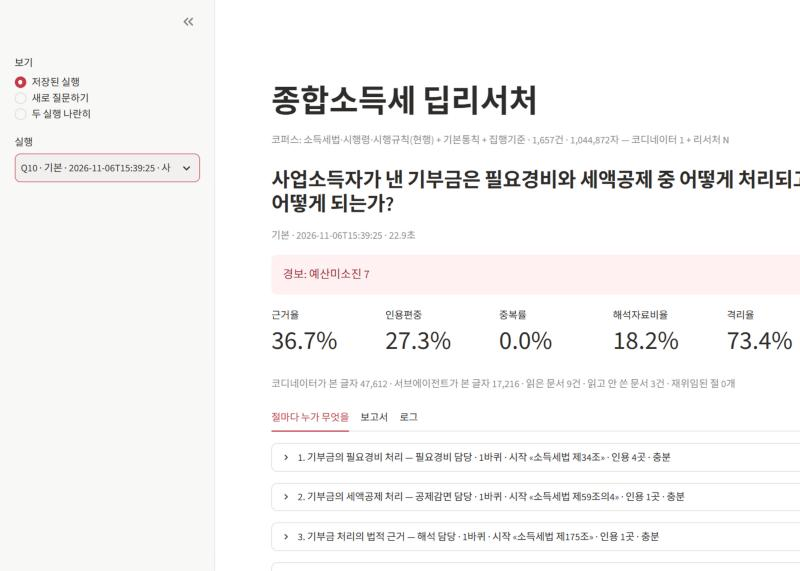
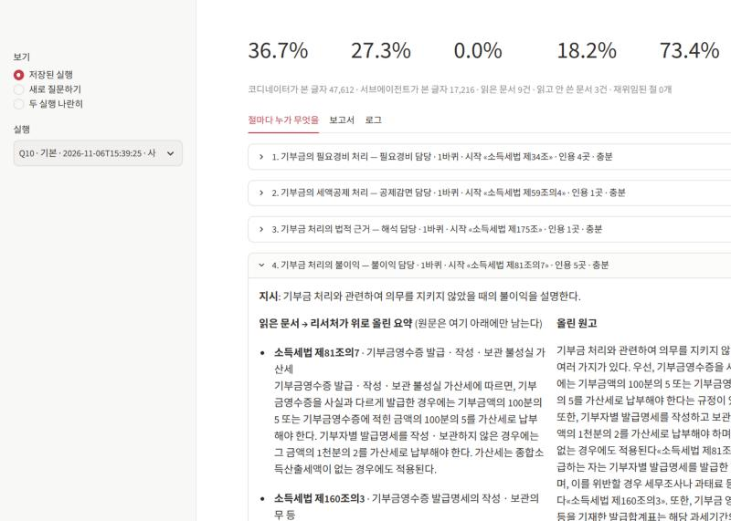

# 종합소득세 딥리서처

종합소득세 질문 하나를 넣으면 코디네이터가 목차를 짜고, 리서처 에이전트 여럿이 소득세법·시행령·시행규칙·기본통칙·집행기준을
나눠 읽어 절 원고를 쓰고, 편집자가 이어 붙여 근거(«문서명») 달린 장문 보고서를 만든다.
모두의연구소 「딥리서치 에이전트 만들기」 1·2일차 파이프라인을 바탕으로 코퍼스와 질문·역할을 새로 짰다.

## 파일

| 파일 | 내용 |
|---|---|
| `data/corpus.json` | docs(조문·통칙·집행기준 본문) · links(서로 가리키는 관계) · titles · kinds |
| `data/questions.json` | 질문 10건과 "왜 나눌 만한가" |
| `config.json` | 절수 · 절예산 · 바퀴 상한 · 역할 명단 · 장치 스위치 |
| `graph.py` | 기획 → 배치 → 서브에이전트 → 점검 → 종합 → 평가 (LangGraph) |
| `metrics.py` | 정답표 없는 지표 (신호와 경보) |
| `baseline.py` | 단일 에이전트 대조군 (같은 읽기 예산) |
| `ablation.py` | 장치를 하나씩 끄는 실험 → `output/ablation.json` |
| `app.py` | Streamlit 데모 |
| `output/` | `runs.jsonl`(실행마다 한 줄) · `ablation.json` · `reports/` |

## 실행 (Windows PowerShell)

키는 이 폴더 또는 옆 폴더(`../deepresearch-agent`)의 `.env` 에 `OPENAI_API_KEY=sk-...` 한 줄로 둔다. `.env` 는 저장소에 올리지 않는다.

```powershell
cd tax-deep-researcher
```

```powershell
pip install langgraph langchain-openai streamlit
```

모델 없이 흐름만 확인 (비용 0):

```powershell
python graph.py --q Q3 --fake
```

질문 전부 실행:

```powershell
python graph.py --all
```

단일 에이전트 대조군:

```powershell
python baseline.py --q Q3 Q6
```

소거 실험:

```powershell
python ablation.py --q Q3 Q6 --repeat 2
```

데모:

```powershell
streamlit run app.py
```

## 데모 화면





결과와 분석은 [REPORT.md](REPORT.md).
