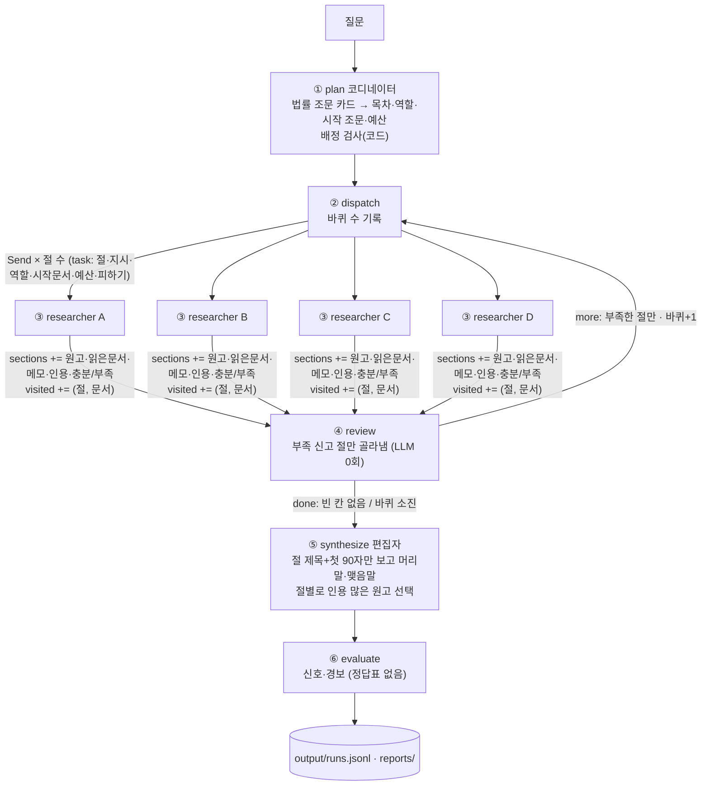
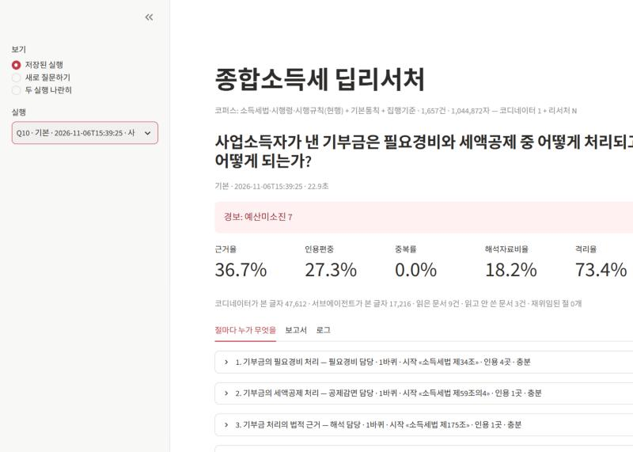
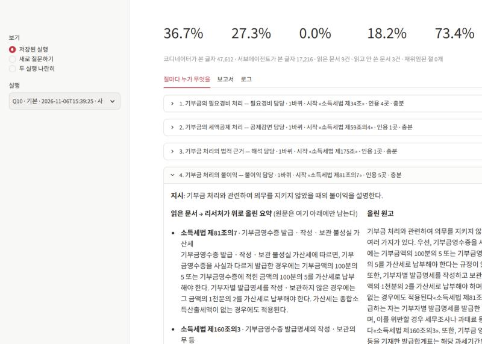

# REPORT — 종합소득세 딥리서처

## 1. 주제와 코퍼스

- **주제**: 개인이 종합소득세를 신고할 때 묻는 질문에 법령 근거를 단 장문 보고서로 답한다. 직접 만들고 있는 종합소득세 신고 앱(간편장부 → 계산 → 전자신고 파일)에서 AI가 맡을 "세법을 모르는 사용자의 신고 안내·상담"의 원형이다.
- **왜 이 구조가 필요한가**: 하나의 답이 법률 조문 → 시행령 → 시행규칙 → 기본통칙·집행기준으로 흩어져 있고, 조문끼리 "법 제27조", "영 제55조"처럼 서로를 가리킨다.
- **자료**: 국가법령정보센터에서 저장한 현행 소득세법(2026. 7. 1. 시행) · 시행령(2026. 10. 1. 시행) · 시행규칙(2026. 7. 1. 시행), 소득세법 기본통칙, 종합소득세 집행기준(2026). 부칙은 2025. 1. 1. 이후 공포된 개정의 부칙만 넣었다(2025·2026년 귀속 적용 규정). 오래된 경과 규정이 리서처의 다음 문서 후보에 섞여 읽기 예산을 쓰는 것을 막기 위해서다.

| 항목 | 값 |
|---|---|
| 문서 수 | 1,657건 (법률 조문 259 · 시행령 357 · 시행규칙 147 · 기본통칙 332 · 집행기준 465 · 부칙 조문 97) — 삭제 조문과 2024년 이전 공포 부칙은 뺐다 |
| 총 글자 수 | 1,044,872자 ≈ 522,436토큰 (교안 환산 2자 = 1토큰) |
| 컨텍스트 윈도우 대비 | `gpt-4o-mini` 128,000토큰의 **4.08배** — 한 번에 넣을 수 없다 |
| 링크 | 7,340개 · 문서당 중앙값 2 |
| 링크 0개 문서 | 39건 — 탐색으로는 닿지 않고 배정으로만 닿는다 |
| 표 깨짐 의심 | 94건 — PDF에서 글자를 뽑을 때 표가 깨진 항목. 보고서 오류를 추적할 때 이 목록과 맞춰 본다 |

## 2. 분업 설계

- **목차는 내용 단위**: 소득 종류·제도·요건·절차처럼 질문이 묻는 덩어리로 나누게 했다. "개요·요건·절차·결론" 같은 형식 단위는 금지(같은 조문을 모두가 읽게 된다).
- **코디네이터가 보는 것**: 법률 조문 259건의 카드(문서명 + 조문 제목 + 앞 150자, 약 4.7만 자). 1,657건 전체 카드는 6만 자를 넘어서 법률 조문만 보여 준다. 시행령·통칙·집행기준은 리서처가 links 를 따라 닿는다.
- **배정 검사(코드)**: 코디네이터가 준 시작 문서가 코퍼스에 없거나 다른 절과 겹치면 코드가 고치고, 고친 것을 `plan.배정수정` 에 남긴다.
- **구역**: 1바퀴에는 다른 절의 시작 문서를, 2바퀴에는 다른 절이 실제로 읽은 문서까지 `피하기` 목록으로 준다.
- **예산**: 4절 × 4건. 조문 하나가 위키백과 문서보다 짧아서(평균 약 630자) 교안의 3건보다 한 건 늘렸다.
- **역할 명단(새로 짬)**: 소득구분 · 필요경비 · 공제감면 · 신고절차 · 불이익 · 해석 담당 (`config.json`).
- **재위임**: 리서처가 스스로 "부족"을 신고한 절만 다시 보낸다. 바퀴 상한 2.
- **두 번째 원고 처리**: 무조건 덮어쓰지 않고 **실제로 읽은 문서를 인용한 수가 많은 쪽**을 남긴다(같으면 두 번째). 교안 소거 실험에서 두 번째 원고가 인용을 빠뜨린 채 멀쩡한 첫 원고를 지운 일이 있었기 때문이다. `config.json` 의 `재위임원고` 를 `"마지막"` 으로 바꾸면 교안 방식이 된다.
- **격리 증명**: 코디네이터가 본 글자와 서브에이전트가 본 글자를 따로 센다(`격리율`).

## 3. 지표 (`metrics.py`, 정답표·판정 모델 없음)

| 지표 | 종류 | 보는 장치 |
|---|---|---|
| 근거율 | 신호 | 절예산·재위임 |
| 인용편중 | 신호 | 배정·구역 |
| 중복률 | 신호 | 배정·구역(피하기 목록) |
| 읽고안쓴 | 신호 | 배정 품질(카드) |
| 해석자료비율 | 신호 | 역할(해석 담당)·링크 탐색 — 조문만 인용했는지, 통칙·집행기준까지 갔는지 |
| 격리율 | 신호 | 컨텍스트 격리 |
| 허위인용 | **경보(0)** | 읽지 않은 문서 인용 |
| 인용0절 | **경보(0)** | 자료 없이 쓴 절 |
| 예산미소진 | **경보(0)** | 대조군이 읽기 예산을 다 썼는지 |

- 문장 나누기: 교안 방식은 «» 가 마침표 뒤에 붙으면 인용이 다음 문장으로 넘어가 근거율이 낮게 나왔다. 제목 줄을 빼고 마침표 뒤 «…» 를 앞 문장에 붙여 센다.
- 읽은 문서를 엉뚱한 문장에 붙인 인용(오귀속)은 어떤 지표로도 잡히지 않는다 → 5절에서 원문과 직접 대조.

## 4. 파이프라인 구조도

State: `question · plan · sections(누적) · visited(누적) · report · metrics · log(누적) · task · prior`

## 5. 결과물 비교

> 지표는 명백한 실패를 거르는 데만 쓰고 순위표로 쓰지 않는다. 모델 `gpt-4o-mini`, 2026-11-06 실행.

### 5-0. 첫 실행에서 찾은 버그 두 개

첫 실행(질문 10건)의 근거율은 평균 **18.4%**, "인용 0곳인 절" 경보가 **14개**였다. 기록을 열어 보니 원인은 모델이 아니라 코드였다.

| 버그 | 증상 | 고친 곳 |
|---|---|---|
| ① 배정 검사 | 카드가 `소득세법 제70조(종합소득과세표준 확정신고)` 꼴이라 코디네이터가 제목까지 붙여 답했고, 코드는 이를 "없는 문서"로 보고 법률 목록 맨 앞(제1조·제1조의2·제2조·제2조의2)으로 바꿨다. 10건 중 9건에서 이렇게 됐다 | `graph.py` plan — 괄호 제목을 떼고 비교 |
| ② 인용 표기 | 자료 머리가 `[문서명 · 제목]` 꼴이고 프롬프트가 "대괄호 앞의 문서명"이라고 해서, 리서처가 `«»` 대신 `[소득세법 제70조]` 로 붙였다. 코드는 `«»` 만 세서 인용이 0으로 잡혔다 | `graph.py` researcher · `baseline.py` — 프롬프트를 고치고, 코퍼스에 있는 `[문서명]` 은 `«문서명»` 으로 바꿈 |

①만 고친 실행은 배정은 맞았지만 근거율이 Q6~Q10 평균 5.4%로 오히려 낮았다. 근거율이 낮은 주원인은 ②였다. 지표가 낮을 때 "모델이 못 한다"고 결론 내기 전에 기록을 직접 열어 봐야 한다는 것을 확인했다.

| | 근거율 평균(10건) | 인용0절 경보 합 | 허위인용 경보 합 |
|---|---|---|---|
| 고치기 전 | 18.4% | 14 | 4 |
| 둘 다 고친 뒤 (`output/runs.jsonl`) | **32.6%** | 4 | 2 |

고친 뒤 질문별 근거율: Q1 14.0 · Q2 33.3 · Q3 35.3 · Q4 42.9 · Q5 39.4 · Q6 25.6 · Q7 28.6 · Q8 21.9 · Q9 48.5 · Q10 36.7 (%).
고친 뒤에도 근거율이 50%를 넘지 못한 것은 리서처가 "소득세법 제73조에 따르면…"처럼 문서명을 본문에 풀어 쓰거나, 절 끝에 일반론 문장("…세무 관리에 큰 영향을 미친다")을 붙이기 때문이다. 이것은 코드가 아니라 모델의 글쓰기 습관이다.

### 5-1. 같은 질문, 보고서 여러 편 (Q6 근로+사업소득 합산·공제)

| 설정 (2회 평균) | 근거율 | 인용편중 | 중복률 | 보고서 자수 |
|---|---|---|---|---|
| 기본 | 25.0% | 21.1% | 5.0% | 약 2,650 |
| 배정·구역 끔 | 28.1% | 15.4% | 12.2% | 약 2,460 |
| 단일 대조군 | 17.5% | 87.5% | 0.0% | 약 1,310 |

- 팀(기본)이 낫다. 단일 대조군은 같은 16건을 읽고도 보고서가 절반 길이이고, 인용의 75~100%가 한 문서에 몰렸다. 한 에이전트가 요약 16개를 한꺼번에 받아 쓰면 첫 문서 위주로 쓴다.
- 배정·구역을 끄면 중복률이 5% → 12%로 올랐다(리서처끼리 같은 조문을 읽음). 근거율이 조금 높은 것은 두 번 실행의 편차(22.9~33.3%) 안이다.

### 5-2. 마음에 안 드는 대목 추적 (Q8 장부·증빙 불이익)

- 대목: "이러한 경우에도 «국세기본법» 제48조 제1항에 따라 가산세의 감면을 받을 수 있는 가능성이 있다." → 허위인용 경보.
- 어느 절에서: 「신고 및 납부 의무」 절, 2바퀴(재위임) 원고. 최종본에 그대로 들어갔다.
- 어느 자료에서: 이 절이 읽은 8건(소득세법 제70조, 집행기준 70-130-2, 기본통칙 70-0…1 등)에는 국세기본법이 없다. 코퍼스 자체에 국세기본법이 없다. 읽은 조문 본문에 "「국세기본법」 제48조"라는 언급이 있었을 수는 있지만, 그 내용(감면 요건)은 읽지 않았으므로 모델 상식으로 쓴 문장이다.
- 고칠 방향: 코퍼스 밖 법령 이름을 «»로 인용하지 못하게 하거나, 국세기본법 가산세 조문(제47조의2~제48조)을 코퍼스에 넣는다.

### 5-3. 인용 원문 대조 (Q10 기부금, 「기부금의 필요경비 처리」 절)

- 대조한 문장: "특례기부금 및 일반기부금의 금액은 … 다음 과세기간 개시일부터 10년 이내에 이월하여 필요경비에 산입할 수 있다 «소득세법 제34조»."
- 원문(제34조 ⑤): 이월 산입 규정은 맞다. 그러나 원문 괄호의 "(제59조의4제4항에 따라 종합소득세 신고 시 세액공제를 적용받은 기부금의 금액은 제외한다)"가 빠졌다.
- 판단: 인용은 제자리에 붙었지만, 질문이 바로 "필요경비와 세액공제 중 어떻게 처리되느냐"인데 두 제도를 잇는 핵심 단서를 놓쳤다. 지표로는 잡히지 않고 원문을 열어야 보인다.
- 추가로 발견: 제34조의 "필요경비 산입한도액" 계산식이 원본 .doc 에서 그림으로 들어 있어 코퍼스에 빈 줄로 남았다. 한도를 묻는 질문에 계산식을 답할 수 없는 이유다.

### 5-4. 이 구조를 쓰면 안 되는 질문 (Q1·Q2)

- Q1 "확정신고는 언제까지?"의 답은 «소득세법 제70조» 한 줄(다음 연도 5월 1일~31일)이다. 그런데 코디네이터는 4절을 짜서 LLM 43회를 불렀고, 「신고 대상 및 요건」 절은 비거주자·국외투자기구 이야기를 썼다. 근거율도 14.0%로 10건 중 가장 낮다.
- Q2도 34회 호출. 단일 조문(소득세법 제160조, 시행령 제208조) 질문에는 단일 에이전트나 검색 한 번이 맞다. 질문 크기를 먼저 판단하는 라우팅이 필요하다.

### 5-5. 소거 실험 (`output/ablation.json`, 설정마다 2회)

| 설정 | Q3 근거율 평균 (범위) | Q6 근거율 평균 (범위) | Q3 인용0절 경보 | 스위치 확인 |
|---|---|---|---|---|
| 기준 | 13.2 (8.1~18.2) | 25.0 (25.0~25.0) | 2, 1 | 확인됨 |
| 배정·구역 끔 | 15.9 (14.6~17.2) | 28.1 (22.9~33.3) | 1, 1 | 확인됨 |
| 역할 끔 | 17.3 (16.2~18.4) | 31.1 (27.0~35.1) | 1, 0 | 확인됨 |
| 재위임 끔 | 20.2 (8.3~32.1) | 40.6 (25.6~55.6) | 2, 3 | 확인됨 |
| 단일 대조군 | 21.9 (20.0~23.8) | 17.5 (16.7~18.2) | 0, 0 | 대조군 |

- 같은 설정 안에서 근거율이 최대 30%p 움직인다(재위임 끔 Q6 25.6~55.6). 2회 반복으로는 장치를 끈 효과를 근거율로 가릴 수 없다.
- 그래도 일관된 것: **재위임은 근거율을 올리지 못했다.** 질문 10건 기본 실행에서 1바퀴 40절 중 9절이 "부족"을 신고해 재위임됐고, 2바퀴 원고 9개가 **모두** 다시 "부족"을 신고했다. 리서처가 원하는 근거(예: 원천징수 세율, 한도 계산식)가 링크를 따라 닿는 4건 안에 없거나 코퍼스에 아예 없기 때문이다. 재위임 끔은 LLM 34회, 재위임이 일어난 실행은 43~52회였다.
- 배정·구역을 끄면 중복률이 Q6에서 5% → 12%로 오른다. 배정·구역은 "같은 조문을 여러 명이 읽는 낭비"를 막는 데는 작동한다.
- 단일 대조군은 Q3에서 근거율이 기준보다 높았지만, 보고서가 약 1,400자로 팀(약 2,300자)의 60% 수준이고 인용편중이 60~75%였다. 근거율 하나로 순위를 매기면 단일이 이기는 것처럼 보인다.
- `예산미소진` 경보는 대조군 공정성을 보려고 만들었는데, 팀 실행에서도 뜬다(Q10 7). 리서처가 따라갈 링크가 떨어지면 예산을 남기고 멈추기 때문이다. 팀 쪽에서는 "링크가 부족한 조문"을 알려 주는 신호로 읽는다.

## 6. 데모 설계

- 보고서만 보여 주지 않고 **절마다 역할 · 시작 조문 · 바퀴 · 읽은 문서와 그 요약 · 올린 원고 · 인용**을 펼쳐 볼 수 있게 했다.
- 인용된 문서는 버튼 하나로 원문을 열어 문장과 대조할 수 있다(오귀속은 사람만 잡으므로).
- 재위임으로 최종본에서 빠진 원고도 "⚠ 최종본에서 빠짐"으로 남겨 보여 준다.
- 경보(허위인용·인용0절·예산미소진)는 화면 맨 위에 색으로 표시한다.
- 두 실행 나란히 보기 탭.
- 화면 캡처 (Q10 기본 실행):

## 7. 회고

- **가장 공들인 부분**: 코퍼스. 법률·시행령·시행규칙·기본통칙·집행기준 1,657건을 조문 단위로 자르고, "법 제27조"·"영 제55조" 같은 참조를 7,340개 링크로 이었다. 리서처가 법률 조문에서 시작해 시행령·통칙으로 내려가는 길이 이 링크다.
- **가장 크게 배운 것**: 지표가 나쁘게 나왔을 때 바로 "장치가 효과 없다"고 결론 내지 않고 기록을 열어 본 것. 첫 실행의 낮은 근거율은 모델이 아니라 문서명 형식이 맞지 않는 버그 두 개 때문이었다(5-0). 같은 형식 문제(카드·자료 머리의 꼴)가 배정과 인용 두 곳에서 따로 터졌다. 모델에게 보여 주는 형식과 코드가 기대하는 형식을 한 곳에서 정해야 한다.
- **기대와 달랐던 것**: 재위임. 교안에서는 깊이를 더하는 장치였지만, 법령 코퍼스에서는 "부족"한 근거가 대개 코퍼스 밖(국세기본법·조세특례제한법)이나 그림으로 빠진 계산식이라, 다시 보내도 찾지 못했다. 재위임 전에 "이 부족이 코퍼스 안에서 채워질 수 있는가"를 판단해야 한다.
- **보완하고 싶은 점**
  - 질문 크기를 먼저 판단하는 라우팅(Q1·Q2 같은 질문은 단일 에이전트로).
  - 국세기본법 가산세 조문과 조세특례제한법 일부를 코퍼스에 추가(Q8·Q9).
  - 원본 .doc 의 그림 계산식과 표가 깨진 집행기준 94건 복원.
  - 인용을 문장 단위로 강제하는 후처리(인용 없는 일반론 문장은 지우거나 표시).
  - 소거 실험 반복 횟수를 늘려(2 → 5 이상) 편차보다 큰 차이만 결론으로 삼기.
- **개인 앱(diy-wai)과의 연결**: 신고 앱의 "상담" 기능은 이 구조 그대로가 아니라, 질문 크기에 따라 단일 조회와 딥리서치를 나누고, 답마다 인용 조문 원문을 열어 볼 수 있게 해야 한다(데모의 인용 대조 기능).
